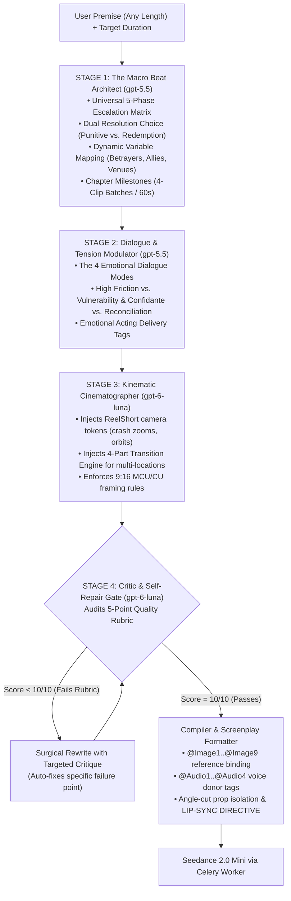
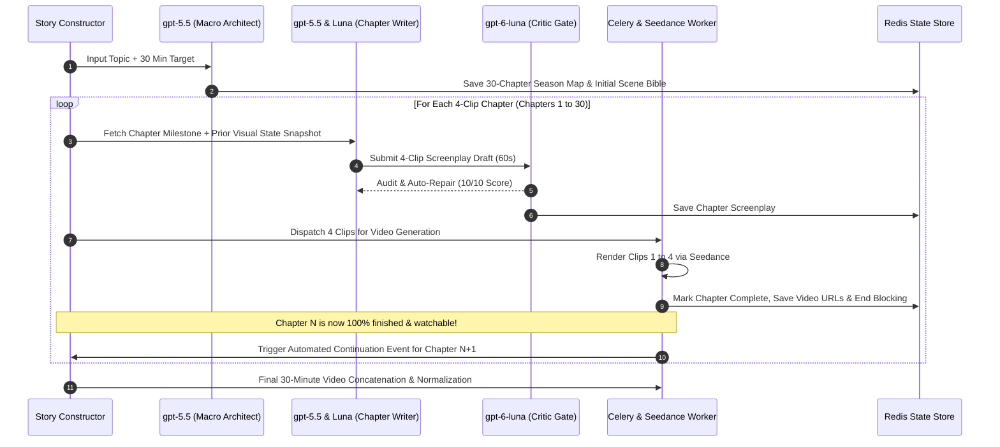

# Story Constructor — Automated Vertical Drama Screenwriting & Cinematography Architecture

## 1. Executive Summary & Core Objective

The **Story Constructor** is an automated multi-stage narrative, dialogue, and cinematography engine designed to produce viral, high-retention vertical dramas (ReelShort, DramaBox, ShortMax caliber) with **zero manual human intervention**.

### The Problem Solved
Previously, creating cinematic, dialogue-rich scripts required manual human-in-the-loop prompt engineering, where an operator had to manually refine dialogue pacing, adjust camera directives, and fix transition mechanics across multiple iterations.

The Story Constructor replaces all manual review with an automated **Showrunner, Screenwriter, Cinematographer, and Critic assembly line**. It pairs `gpt-5.5` (high-level narrative architecture, emotional dialogue, and relationship psychology) with `gpt-6-luna` (cinematic choreography, fast formatting, and strict automated quality auditing) to feed `bytedance/seedance-2-mini` via kie.ai.

### Universal Genre Approach: Revenge, Romance & Redemption
The engine does **not** hardcode any single plot (such as a cheating husband, a fashion designer, or a specific stolen object). Instead, it codifies the **Universal Emotional Drama & Romance Framework**—a flexible, variable-driven architecture capable of executing both:
1. **Punitive Revenge & Upgrade Romance**: Where arrogant bullies face total public ruin and the protagonist is crowned alongside a superior partner.
2. **Redemption & Second-Chance Reconciliation**: Where estranged partners or family members confront mistakes, heal misunderstandings, face emotional catharsis, and genuinely redeem their relationship.

---

## 2. Pacing Physics & The 15-Second Time Budget

A 15-second vertical clip is a strict physical container. To prevent robotic delivery and maintain intense dramatic momentum, the Story Constructor enforces **Tempo Modulation** across distinct clip types:

```
┌──────────────────────────────────────────────────────────────────────────────────┐
│                             15-SECOND TIME ALLOCATION                            │
│                                                                                  │
│ 1. Clash / High-Stakes Confrontation (45–55 words):                              │
│    [████████████████████████████████████████████████████░░]                      │
│    Speech: 13–14s | Action Breathers: 1–2s                                       │
│                                                                                  │
│ 2. Emotional Vulnerability / Confidante / Redemption (30–45 words):              │
│    [██████████████████████████████████████░░░░░░░░░░░░░░]                       │
│    Speech: 9–11s  | Tears, Hugs, Emotional Breathers & Reactions: 4–6s          │
│                                                                                  │
│ 3. Hybrid Drama & Motion (30–40 words):                                          │
│    [██████████████████████████████░░░░░░░░░░░░░░░░░░░░░░]                       │
│    Speech: 8–10s  | Physical Action, Props & Cuts: 5–7s                          │
│                                                                                  │
│ 4. Kinetic Action / Romance / Transition (15–25 words):                          │
│    [████████████████░░░░░░░░░░░░░░░░░░░░░░░░░░░░░░░░░░░]                       │
│    Speech: 4–6s   | Pure Motion, Slide Transitions, Romance: 9–11s               │
└──────────────────────────────────────────────────────────────────────────────────┘
```

### Pacing Guidelines:
1. **Dialogue Delivery Rate**: Spoken dialogue targets **~3.3 to 3.8 words per second**.
2. **Turn Frequency**: Dense clips contain **4 to 7 sharp turns**. Monologues are forbidden; every line has emotional stakes.
3. **Action Space Reservation**: Clips that require physical stunts, venue entrances, crying embraces, prop handoffs, or lateral slide transitions automatically scale dialogue down to **25–38 words**, guaranteeing 4–8 seconds of unvoiced screen time for camera sweeps, physical acting, and emotional resonance.

---

## 3. The 4-Stage Multi-Agent Assembly Line

The pipeline enforces strict **Separation of Concerns**. No single prompt is burdened with handling story, dialogue, camera angles, timing, and Seedance tags simultaneously.



---

### Stage 1: The Macro Beat Architect (`gpt-5.5`)

Stage 1 extracts the core dramatic relationships from the user's input and binds them to the **Universal Escalation Matrix**. 

#### Chapter Architecture (60 Seconds / 4 Clips per Chapter):
- The story is produced in sequential **Chapters of 60 seconds (4 clips × 15s each)**.
- **Strict Sequential Flow**: The system generates **Chapter 1 Script** $\rightarrow$ renders **Chapter 1 Videos (4 clips)** to completion $\rightarrow$ snapshots Chapter 1's actual visual/narrative end-state $\rightarrow$ generates **Chapter 2 Script** via the automated continuation loop $\rightarrow$ renders **Chapter 2 Videos**, and so forth.

#### Resolution Choice:
- **Path A: Punitive Revenge & Upgrade Romance**: Arrogant antagonists face total public ruin, exposed crimes/cruelty, and begging on knees rejected; protagonist is elevated and crowned alongside a vastly superior benefactor/partner.
- **Path B: Redemption, Reconciliation & Second Chance**: Estranged partners or family members confront painful truths, heal deep wounds, defeat external saboteurs, humble their pride, earn genuine forgiveness, and rebuild their bond stronger than before.

#### The Modular Story Variable Engine:
The architect dynamically populates these structural slots from the user's prompt:

| Structural Variable | Variable Archetypes / Options | Examples across Different Stories |
|---|---|---|
| **The Source of Conflict** | Unfaithful Partner / Greedy Family / Jealous Siblings / External Saboteur / Tragic Misunderstanding | • Toxic partner & arrogant mistress<br>• Ungrateful adult children & greedy in-laws<br>• Scheming third party manipulating both spouses |
| **The Injustice / Loss** | Eviction / Theft of Life Savings / Broken Marriage / Framed Disgrace | • Stripped of rights, dignity & home<br>• Evicted from pension & family house<br>• Devastating emotional estrangement |
| **The Confidante / Emotional Anchor** | Loyal Best Friend / Devoted Sibling / Wise Elder / Longtime Confidante | • Best friend who holds them as they weep<br>• Loyal sibling who rallies behind them<br>• Elder who sees through the lies |
| **The Catalyst / Meeting Venue** | Vulnerable Public Space / Accidental Collision / Structured Event / Shared Crisis | • Rain-slicked park bench / street<br>• Dating reality show / blind date<br>• Hospital bedside / shared family emergency |
| **The Counterpart Lead** | High-Status Benefactor / Estranged Spurred Spouse Seeking Redemption / Undercover Tycoon | • Powerful rival half-brother<br>• Remorseful spouse desperate to make amends<br>• Secret billionaire in disguise |
| **The Climax Arena** | High-Society Banquet / Industry Showcase / Charity Gala / Intimate Sacred Sanctuary | • Fashion runway / product launch<br>• Billionaire corporate annual gala<br>• Intimate rain-drenched doorstep or family home |

#### The Universal 5-Phase Escalation Matrix:

1. **Phase 1: The Rupture & The Stripping (Rock Bottom)**
   - Protagonist suffers an extreme rupture, betrayal, or cruel misunderstanding.
   - Stripped of dignity, home, assets, or emotional security.
   - A tangible, physicalized loss occurs (belongings thrown in rain, heirloom stolen, wedding ring dropped, papers slammed).

2. **Phase 2: The Fateful Collision & The Emotional Anchor**
   - Protagonist faces their lowest, most vulnerable point.
   - **The Confidante Beat**: Protagonist breaks down, weeps with a trusted friend/family member, and processes the grief (*"How could they do this to me?"*).
   - Collision with the counterpart lead (a high-status benefactor offering an alliance, or an estranged partner realizing the catastrophic error).
   - A fateful token or invitation is extended (business card, coat, umbrella, second chance plea).

3. **Phase 3: The Transformation & The Awakening**
   - A pivotal agreement or transformation occurs (revenge contract, flash marriage, protective sanctuary, or hard-won second chance).
   - Protagonist undergoes a dramatic status upgrade or emotional healing.
   - Intimate emotional chemistry and vulnerability blossom behind closed doors; physical proximity creates tension and comfort.

4. **Phase 4: Hubris or Desperate Awakening**
   - *In Revenge Path*: Antagonists bask in delusional triumph while secretly crumbling; high dramatic irony.
   - *In Redemption Path*: The remorseful party discovers the true extent of the betrayal/manipulation, cuts ties with the corrupt third party, and rushes through the rain/crisis to make things right.

5. **Phase 5: The Grand Climax & Resolution**
   - *Path A (Punitive Revenge)*: Public arena confrontation; antagonist's fraud exposed; kneeling apologies coldly rejected; security ejection; protagonist crowned alongside the new partner with a passionate embrace.
   - *Path B (Redemption & Reconciliation)*: Public or intimate showdown where the real saboteur is exposed; the remorseful partner humbles their pride, bares their soul, and asks for the chance to spend life making amends; tearful forgiveness, passionate reconciliation kiss, and mutual coronation.

---

### Stage 2: The Dialogue & Tension Modulator (`gpt-5.5`)

`gpt-5.5` writes moment-to-moment dialogue using **4 Emotional Dialogue Modes**. Zero polite small talk is allowed; every line carries profound stakes.

```
┌──────────────────────────────────────────────────────────────────────────────────┐
│                          THE 4 EMOTIONAL DIALOGUE MODES                          │
├──────────────────────────────────────────────────────────────────────────────────┤
│ 1. CONFLICT & CONFRONTATION (High Friction)                                      │
│    • Word Count: 45–55 words across 5–7 rapid turns.                             │
│    • Energy: Ultimatums, rapid verbal jabs, accusations, desperate panic.        │
│    • Delivery Tags: (smirking with icy disdain), (shouting in frantic denial).   │
│                                                                                  │
│ 2. VULNERABILITY & GRIEF (Deep Catharsis / The Confidante Beat)                  │
│    • Word Count: 30–45 words (with breathers for sobbing/embraces).              │
│    • Energy: Crying to a friend, asking "Why?", admitting feeling broken.       │
│    • Delivery Tags: (voice breaking into a sob), (whispered in choked grief),    │
│                     (holding her tightly, fiercely protective).                  │
│                                                                                  │
│ 3. TENDERNESS & ROMANTIC HEALING (The Heart / Dopamine)                          │
│    • Word Count: 25–38 words (leaving 5–8s for eye contact, brushing tears).     │
│    • Energy: Gentle comfort, unspoken yearning, soft vows of protection.         │
│    • Delivery Tags: (softly, wiping a tear from her cheek), (eyes welling with   │
│                     quiet adoration), (a breathless, tender whisper).            │
│                                                                                  │
│ 4. REMORSE, REDEMPTION & RECONCILIATION (The Second Chance)                      │
│    • Word Count: 30–45 words (weighty, sincere, soul-baring).                    │
│    • Energy: Admitting guilt, asking for forgiveness, choosing love over pride.   │
│    • Delivery Tags: (voice trembling with genuine remorse), (kneeling before her,│
│                     letting down his pride), (softening, taking his hands).      │
└──────────────────────────────────────────────────────────────────────────────────┘
```

---

### Stage 3: The Kinematic Cinematographer (`gpt-6-luna`)

`gpt-6-luna` takes the raw beats and dialogue, weaving in the visual kinetic vocabulary that prevents Seedance from rendering static scenes:

1. **ReelShort Kinematic Directives**:
   - `[Crash zoom into [CHARACTER]'s sharp face as he turns around with cold authority]`
   - `[Dynamic 180-degree orbiting arc shot revolving around the desk/table]`
   - `[Macro crash zoom on [PROP] as [CHARACTER] [ACTION]]`
   - `[Top-down slow-mo shot: [OBJECT] crashes beside her shoes, [SUBSTANCE] bursting across the floor]`
   - `[Over-the-shoulder push-in establishing active speaker]`
   - `[Slow tender push-in as [CHARACTER] wipes a tear from [CHARACTER]'s cheek]`

2. **Fluid Multi-Location Staging**:
   The screenwriter has total creative freedom:
   - It can remain in a single room if the scene is an intense dialogue duel or an intimate weeping confession.
   - Or it can fluidly split the 15-second clip across two locations whenever narrative momentum demands it.

---

### Stage 4: The Automated Critic & Self-Repair Gate (`gpt-6-luna`)

**This component completely eliminates manual human intervention.**
Every generated clip is audited against a strict 5-Point Quality Rubric before it can proceed:

| Rubric Dimension | Requirement | Failure Action |
|---|---|---|
| **1. Pacing & Density** | Word count strictly matches clip type (45–55w for clashes, 30–45w for grief/redemption, 25–38w for motion/romance). | Prompted to expand verbal exchanges or trim filler. |
| **2. Kinematic Directives** | Contains at least 2 active camera movements (`crash zoom`, `orbiting arc`, `macro zoom`, `push-in`). Tripod words (`medium shot of them talking`) are banned. | Automatically re-angles and injects dynamic movement cues. |
| **3. Transition Verification** | If spanning 2 locations, must have all 4 parts of the Transition Blueprint (especially the motivated physical exit vector). | Auto-injects actor exit momentum and transition token. |
| **4. Foreground Cast vs. Crowds** | Max 2–3 named/speaking characters in active foreground; background extras & crowds allowed in soft focus. | Re-stages multi-speaker flat wide shots into close-up angle cuts. |
| **5. Physical / Prop Causality (Conditional)** | If props are present, they must be physically handled/passed; if no props, physical blocking (steps, gestures, tears) must be motivated. | Injects physical interaction or blocking steps before lines. |

#### Rubric Clarification: Foreground Cast Limits vs. Background Crowds
- **Named / Speaking Focus Characters (Strict Limit: Max 2–3 in Active Frame)**:
  - Bound to reference images (`@Image`) and voice donors (`@Audio`).
  - Require high pixel density in vertical 9:16 for clean facial likeness and accurate lip-sync.
  - Active dialogue must cut between active speakers in MCU/CU rather than holding 4+ named characters side-by-side in a flat wide shot.
- **Background Extras / Atmospheric Crowds / Living Set Dressing (Unlimited & Encouraged)**:
  - Allowed and encouraged for scale, realism, and high production value (e.g., *"panicked office staff scrambling in the background"*, *"packed luxury auditorium leaping into a standing ovation"*, *"stunned onlookers murmuring in soft focus"*, *"security guards"*, *"passersby under umbrellas in the rain"*).
  - Treated as environmental atmosphere rendered in **soft focus / shallow depth of field (bokeh)**, from behind, or as part of wide establishing pans.
  - They have **no individual reference images**, **no dialogue lines**, and **no lip-sync directives**, so Seedance renders them as living depth without face distortion.

If a clip scores below 10/10, the Critic issues a targeted critique, and Luna performs an immediate surgical rewrite of that single clip.

---

## 4. Multi-Location Fluidity & The 4-Part Transition Engine

When a 15-second clip naturally bridges two physical settings, the prompt compiler automatically formats it using the **4-Part Transition Blueprint**:

```
1. Compound Location Declaration:
   [LOCATIONS: loc_a, loc_b]

2. Motivated Physical Exit Vector (Location A, ~0–7s):
   An actor or camera clears the frame along a definite spatial direction.
   Example: [Security guards haul [ANTAGONIST] backward down the aisle as he thrashes frantically...]
   Example: [[CHARACTER] flees through the heavy front doors into the pouring rain...]

3. Kinematic Transition Keyword (~7–8s):
   Specific diffusion transition tokens that trigger Seedance's cross-attention sweeps:
   • "Lateral whip-pan slide to [LOCATION B]"
   • "Whip-pan match cut to [LOCATION B]"
   • "Speed wipe transition to [LOCATION B]"
   • "Match cut on action to [LOCATION B]"

4. Destination Arrival & Arrival Blocking (Location B, ~8–15s):
   Immediate visual arrival and continuation of the scene in the new set.
   Example: [...camera lands smoothly on [LOCATION B] as the panoramic night horizon glows behind them.]
```

### Reference Image Budgeting (Kie.ai 9-Slot Allocation):
Kie.ai supports up to 9 reference images (`MAX_REF_IMAGES = 9`). When a clip spans two sets, reference slots are dynamically allocated:
- **Location A (Empty Plates)**: 3 multi-angle images (`@Image1, @Image2, @Image3`)
- **Location B (Empty Plates)**: 3 multi-angle images (`@Image4, @Image5, @Image6`)
- **Active Cast References**: 3 high-res FLUX face portraits (`@Image7, @Image8, @Image9`)

This ensures photorealistic rendering across both sets with zero geometric distortion or face morphing during the cut.

---

## 5. Diffusion Video Physics & Anti-Warping Safeguards

To prevent object morphing, face melting, and multi-mouth lip-sync spasms in Seedance, the compiler enforces three non-negotiable rules:

### 1. Angle Cuts Between Physical Prop Actions (Conditional — Applies ONLY When a Prop is Present)
*(Note: Physical props are completely optional per scene. Pure dialogue confrontations, emotional confessions, walking in the rain, or weeping scenes naturally proceed without any props.)*

Diffusion models warp objects if an actor suddenly creates or spawns an item in an uninterrupted take. If and only if a scene organically involves an item (e.g., keys, a phone, coffee, a document, an umbrella, a gift):
- The compiler enforces an **angle cut before the item is handled or passed**, ensuring Seedance renders the object cleanly in a new perspective rather than morphing it out of thin air.

*Illustrative Example (Hypothetical Scene — Not a Hardcoded Requirement):*
- *Shot 1*: Character enters or gestures empty-handed.
- *Angle Cut to Shot 2 (Close-up)*: Camera cuts to establishing the item already in hand or on the surface.
- *Angle Cut to Shot 3 (Macro Zoom / Over-the-shoulder)*: Item placed, slid, or passed.
- *Angle Cut to Shot 4 (Tight Close-up)*: Reaction shot of the receiver.

### 2. 9:16 Tight Framing Policy (Preventing Face Melt)
Wide group shots in vertical 9:16 allocate too few pixels to faces, causing facial distortion.
- Dialogue is strictly framed in **Medium Close-Up (MCU)** or **Close-Up (CU)** (waist-up or tighter).
- Faces are positioned at **three-quarter angles ($45^\circ$)**, never flat 90-degree side profiles, ensuring both eyes and mouth are clearly resolved.

### 3. Dedicated Lip-Sync Directives (No Multi-Mouth Blending)
Every clip prompt includes the compiled directive:
```text
LIP-SYNC DIRECTIVE: The camera establishes each speaker in Close-up before their line begins. 
Synchronize lip movement exclusively onto the active speaker of each line; 
non-speaking characters keep mouths strictly closed and do not animate lips. 
Fluid natural physical acting throughout. No background music.
```

---

## 6. Scaling to 30 Minutes: Sequential Chapter Execution & Continuation Loop

Thirty minutes of content equals **120 clips** (thirty 4-clip chapters, exactly 60 seconds each). The pipeline enforces strict **Sequential Chapter Execution**: Chapter 1 is written and completely rendered before Chapter 2 begins, ensuring 100% visual and narrative continuity.



### State Preservation Between Chapters:
1. **End-State Blocking**: The exact ending poses, screen profile, and gaze direction of characters in Clip 4 carry over into Clip 1 of the next chapter.
2. **Prop Tracking**: Items held, dropped, or passed maintain physical continuity across chapter boundaries.
3. **Dynamic Scene Bible Extension**: When a chapter introduces a new location or supporting character, the continuation engine automatically adds them to the Scene Bible and generates their FLUX portraits without altering existing assets.

---

## 7. Modular Genre Profile Schema

The engine is architected around swappable **Genre Profile Configurations**. The Universal Revenge, Romance & Redemption profile is defined as follows:

```json
{
  "genre_id": "revenge_romance_redemption",
  "display_name": "Universal Revenge, Romance & Redemption",
  "pacing_matrix": {
    "clash_words": "45-55",
    "vulnerability_grief_words": "30-45",
    "remorse_redemption_words": "30-45",
    "motion_romance_words": "25-38",
    "delivery_speed_wps": "3.5"
  },
  "camera_vocabulary": [
    "Crash zoom",
    "Dynamic 180-degree orbiting arc",
    "Macro crash zoom",
    "Top-down slow-mo drop",
    "Whip-pan match cut",
    "Lateral whip-pan slide",
    "Slow tender push-in on tears"
  ],
  "transition_toolkit": [
    "lateral_whip_pan_slide",
    "match_cut_on_action",
    "speed_wipe",
    "time_dissolve_montage"
  ],
  "structural_variables": {
    "resolution_options": ["punitive_revenge_coronation", "redemption_reconciliation_healing"],
    "conflict_sources": ["unfaithful_partner", "greedy_family_in_laws", "jealous_siblings", "tragic_misunderstanding", "external_saboteur"],
    "confidante_types": ["loyal_best_friend", "protective_sibling", "wise_elder_mentor"],
    "meeting_venues": ["vulnerable_street", "blind_date_reality_show", "mistaken_venue", "accidental_rescue", "hospital_crisis"],
    "counterpart_roles": ["rival_alpha_benefactor", "remorseful_estranged_spouse", "undercover_tycoon"],
    "climax_arenas": ["society_banquet_gala", "public_showcase_runway", "corporate_boardroom", "sacred_reconciliation_home"]
  },
  "lighting_and_atmosphere": "High-contrast luxury environments paired with raw vulnerable rain/street settings, warm amber romantic lighting, and strobe/flashbulb climaxes"
}
```

---

## 8. Summary of Implementation Mandate

1. **Universal Emotional Architecture**: No hardcoded plots. Supports both punitive revenge face-slap climaxes and tearful second-chance reconciliations.
2. **The 4 Emotional Modes**: Guarantees rich dialogue covering high-friction conflict, tearful vulnerability with trusted confidantes, gentle romantic healing, and heartfelt remorse/redemption.
3. **Batching**: Standardize on **4-clip chapters (60 seconds)**.
4. **Cinematography**: Enforce kinetic camera directives and the 4-part transition engine for compound locations.
5. **Quality Control**: Automated Critic Gate on `gpt-6-luna` performs self-repairs, completely eliminating manual prompt editing.
6. **Sequential Execution**: Strict Chapter Script $\rightarrow$ Chapter Video rendering $\rightarrow$ Next Chapter flow via automated continuation, scaling seamlessly to 30 minutes (30 chapters).
